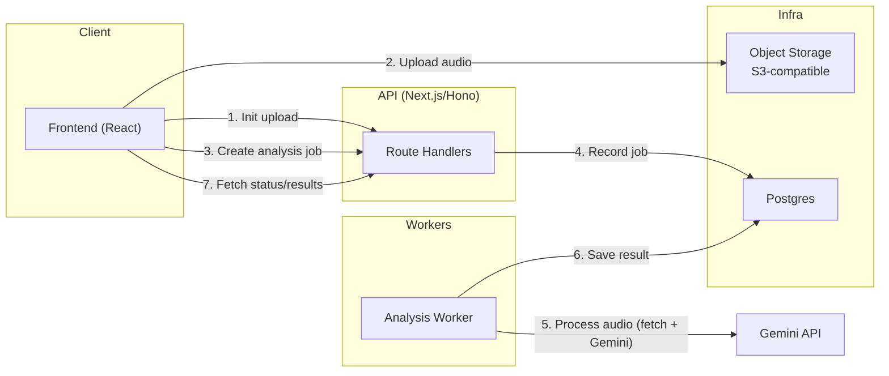
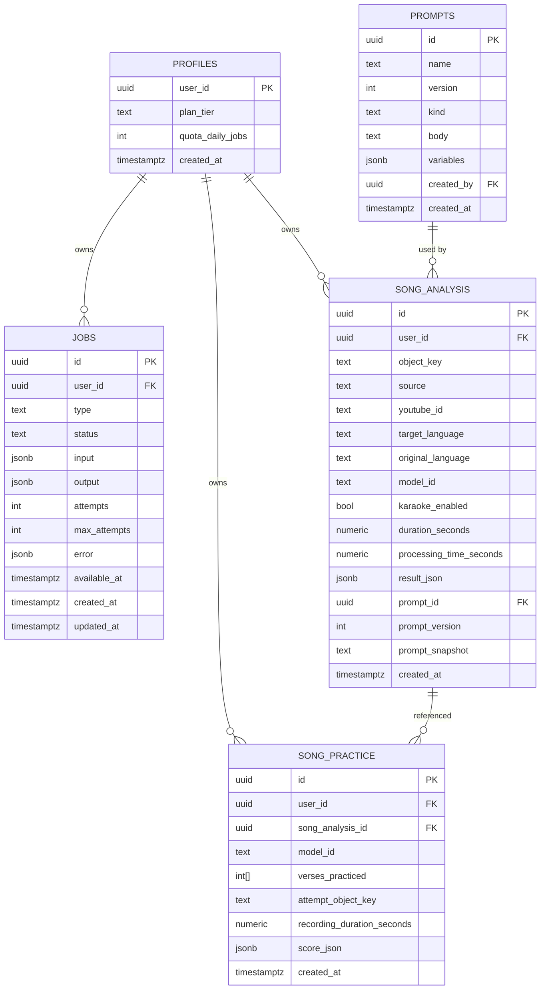

# Babelback: Design

## v1 Draft

This document lays out a pragmatic v1 design to move AI and heavy logic to the backend, add auth/users, and introduce a reliable YouTube ingestion pipeline powered by a Python FastAPI service with yt-dlp and Supabase Storage. It also defines a jobs system in Postgres, server-side persistence of analysis/practice results, and a thin, secure frontend.

### Goals & Scope
- Backendify: Move Gemini calls, parsing, and persistence from the frontend to Hono.
- Auth + users: Secure, multi-tenant model with per-user quotas and storage isolation.
- Ingestion: Direct-to-storage uploads + YouTube URL processing (yt-dlp) with normalized audio.
- Jobs: Durable, retryable job records in Postgres with progress and error details.
- Persistence: Store media in Supabase Storage and metadata/results in Postgres.
- Entities: users, prompts, song_analysis, song_practice, jobs.

---

### Architecture Overview
- Frontend (React): Thin client. Auth, upload/initiation, progress UI, reads results. No secrets.
- API (Hono on Vercel):
  - Edge routes: mint GCS signed URLs (PUT/GET), start jobs, SSE fan‑out.
  - Node routes: receive webhooks/callbacks, handle larger I/O, persist job status.
  - Uses `@google/genai` server‑side; persists to Postgres and Supabase.
- Apify Actor (yt‑dlp): Runs downloads with proxy when needed. On success, uploads audio directly to GCS via a Hono‑minted signed PUT and calls back Hono.
- Postgres (Supabase): Job queue + metadata/results.
- Storage (GCS): Audio blobs (private), practice recordings, optional JSON result dumps.
- Realtime/Progress: SSE on Hono for the download→GCS workflow; elsewhere Supabase Realtime on `jobs` or FE polling for v1.

---

### Key Flows

1) Upload Audio (streaming proxy → GCS)
- FE → Hono (Node): `POST /api/uploads/audio` with raw file body. Headers: `Content-Type`, `x-file-name`.
- Hono streams to GCS (resumable) and returns a short-lived signed GET URL + `gcsObject`.
- FE → `POST /api/song-analysis` with `{ audioUrl, fileName, mimeType, targetLanguage, karaoke, modelId }`.
- Hono performs analysis and returns `SongData`. This flow is identical to the YouTube path once a GCS object exists.

2) YouTube Ingestion (Apify Actor + GCS)
- FE → Hono: `POST /api/downloads` with `youtubeUrl` and options. Hono mints an `uploadUrl` (V4 signed PUT) and starts the Apify run.
- Apify Actor (yt-dlp) downloads the source (proxy if needed) and `PUT`s audio to `uploadUrl`. It then POSTs a callback with `{ jobId, status, bytes, contentType }`.
- FE polls `GET /api/downloads/:id` (or listens on SSE) to obtain the signed read URL, then calls `/api/song-analysis` (same as manual upload).

3) Practice Scoring
- FE → API: POST `/v1/uploads/practice` with recording blob; API stores and returns `objectKey`.
- FE → API: create `practice` job with `song_analysis_id`, verse selection, model_id, and `objectKey`.
- Worker runs scoring LLM → stores `SingingScore` in `song_practice`, marks job done.
- FE displays results; library shows practice history.

---

### API (Next.js/Hono) – v1 Surface
- Auth
  - `GET /v1/auth/me` → current user
- Uploads (server-side streaming)
  - Implemented: `POST /api/uploads/audio` → binary stream upload (Content-Type + x-file-name header). Streams request body directly to GCS using a resumable write; responds with `{ id, url (signed GET), gcsObject: { bucket, path, contentType, size } }`.
  - Rationale: avoids vendor size limits and keeps credentials on the server; the browser never sees GCS keys. No bucket CORS is required for upload because the browser posts to our API.
  - Alternatives (future):
    - Direct browser → GCS (V4 signed PUT). Pros: server doesn’t relay bytes. Cons: requires signed PUT, strict headers, and bucket CORS; single-shot uploads can be brittle.
    - Signed resumable session (chunked PUTs). Best for very large files, but more client complexity.
  - Practice uploads can mirror the same pattern at `/api/uploads/practice`.
- Jobs
  - `POST /v1/jobs/analysis` → create analysis job for an existing object key
  - `POST /v1/jobs/youtube` → create yt_ingest job { youtubeUrl, opts }
  - `POST /v1/jobs/practice` → create scoring job
  - `GET /v1/jobs/:id` → status, progress, errors, linked record ids
  - `GET /v1/jobs` → filter by type/status (optional for v1)
- Results
  - `GET /v1/analysis/:id` → SongData JSON + metadata
  - `GET /v1/analysis` → list user analyses (paginated)
  - `GET /v1/practice/:id` → SingingScore JSON + metadata
  - `GET /v1/practice` → list user practices (paginated)
- Prompts
  - `GET /v1/prompts` → templates + versions
  - `POST /v1/prompts` (admin) → create/update with versioning
- Webhooks (HMAC signed)
  - `POST /v1/webhooks/yt-complete` → from Python service: object key + metadata

---

### Data Model (Postgres)

Users (via Supabase Auth suggested)
- Use `auth.users` + `profiles` table for app-specific fields.

Prompts
- Stores prompt templates with versions and variables for reproducibility.

Jobs (single queue for all task types)
- Durable, retryable; claimed via `FOR UPDATE SKIP LOCKED`.

Song Analysis
- Server-side results of AI analysis for a user’s audio/YouTube input.

Song Practice
- Server-side practice attempts and AI scores.

Example DDL (starter)
```sql
-- profiles (if using Supabase Auth)
create table if not exists profiles (
  user_id uuid primary key references auth.users(id) on delete cascade,
  plan_tier text default 'free',
  quota_daily_jobs int default 50,
  created_at timestamptz default now()
);

create table if not exists prompts (
  id uuid primary key default gen_random_uuid(),
  name text not null,
  version int not null,
  kind text check (kind in ('analysis','scoring')) not null,
  body text not null,
  variables jsonb default '{}'::jsonb,
  created_by uuid references auth.users(id),
  created_at timestamptz default now(),
  unique (name, version)
);

create table if not exists jobs (
  id uuid primary key default gen_random_uuid(),
  user_id uuid references auth.users(id) not null,
  type text check (type in ('yt_ingest','analysis','practice')) not null,
  status text check (status in ('pending','running','succeeded','failed','canceled')) not null default 'pending',
  input jsonb not null,
  output jsonb default '{}'::jsonb,
  attempts int not null default 0,
  max_attempts int not null default 3,
  error jsonb,
  available_at timestamptz default now(),
  created_at timestamptz default now(),
  updated_at timestamptz default now()
);
create index on jobs (status);
create index on jobs (type);
create index on jobs (user_id);

create table if not exists song_analysis (
  id uuid primary key default gen_random_uuid(),
  user_id uuid references auth.users(id) not null,
  object_key text not null,
  source text check (source in ('upload','youtube')) not null,
  youtube_id text,
  target_language text not null,
  original_language text,
  model_id text not null,
  karaoke_enabled boolean default false,
  duration_seconds numeric,
  processing_time_seconds numeric,
  result_json jsonb not null,
  prompt_id uuid references prompts(id),
  prompt_version int,
  prompt_snapshot text,
  created_at timestamptz default now()
);
create index on song_analysis (user_id);
create index on song_analysis (youtube_id);

create table if not exists song_practice (
  id uuid primary key default gen_random_uuid(),
  user_id uuid references auth.users(id) not null,
  song_analysis_id uuid references song_analysis(id) on delete cascade not null,
  model_id text not null,
  verses_practiced int[] not null,
  attempt_object_key text not null,
  recording_duration_seconds numeric,
  score_json jsonb not null,
  created_at timestamptz default now()
);
create index on song_practice (user_id);
create index on song_practice (song_analysis_id);
```

Row-Level Security (recommended)
- Enable RLS and add policies such as `using (user_id = auth.uid())` for all user-owned tables.

---

### Storage Layout (Object Store)
- Bucket: `media`
  - Upload audio: `users/{userId}/ingest/{uuid}_{origName}`
  - Normalized audio: `users/{userId}/normalized/{uuid}.opus` (or `.wav` 16kHz)
  - Practice: `users/{userId}/practice/{analysisId}/{timestamp}.webm`
  - Results (optional): `users/{userId}/results/{analysisId}.json`
- No direct client writes: API owns credentials and streams uploads to storage. For downloads, serve time-limited signed GET URLs or proxy via API.

---

### Auth & Authorization
- Prefer Supabase Auth:
  - Hono validates JWT, injects `user_id`.
  - RLS enforces per-user access to DB rows.
  - Storage policies constrain objects to the owner’s path.
- Alternative: Auth.js/Clerk with service credentials to Supabase (more custom policy work).

---

### Job Orchestration
- Workers claim `jobs` with `FOR UPDATE SKIP LOCKED where status='pending' and available_at <= now()`.
- Retries: increment `attempts`, set `available_at` on backoff; move to `failed` after `max_attempts`.
- Progress: update `jobs.output.progress_percent`, track stage and timestamps; FE polls or subscribes.
- Idempotency: de-duplicate by `(youtube_id, model_id, lang, karaoke, prompt_version)` or `(object_key, param set)`.

---

### AI Processing (Server-side)
- Analysis:
  - Read from Storage (signed URL or server credentials), upload to Gemini files API.
  - Provide `responseSchema` and strict prompts.
  - Parse/normalize on server; store `result_json` and timings.
- Scoring:
  - Convert practice Blob to base64 inline data.
  - Prompt with transliteration references + relative timings derived from analysis data.
- Guards:
  - Enforce max audio length; standardize to mono/48k (Opus/WAV) to improve speed and reliability.

---

### Security
- Server-side uploads with size/type/content validation at API layer; use signed GET URLs for downloads if needed.
- HMAC-signed webhooks between Python and Hono.
- Rate limiting per user/IP (Redis or Postgres sliding window).
- Secrets in managed secret store; never expose to client.

---

### Observability
- Structured logs with job IDs and durations.
- Store failure details in `jobs.error` (truncate long payloads responsibly).
- Metrics: job counts, latencies, failure rates, LLM usage proxies.
- Optional Sentry for FE + BE.

---

### Caching & Dedup
- Hash normalized audio (SHA256) to avoid duplicate analyses for same params.
- YouTube dedup by `youtube_id` + parameter set.

---

### Limits & Quotas
- `profiles` tracks plan tiers and daily quotas.
- Limit job creation per day, audio length, and practice attempts.
- Gate advanced models (Pro) or karaoke mode by plan.

---

### Prompt Management
- `prompts` table versioning.
- Snapshot resolved prompt per job/record for reproducibility.
- Keep schema and prompt in sync; update schema first when expanding output shape.

---

### (Historical) Python Worker
Earlier drafts used a custom Python worker (Cloud Run/Functions). This has been replaced by the Apify Actor approach for simpler operations, proxy support, and no in‑house worker fleet.

---

### Apify Actor Downloader (yt‑dlp)

- Actor input: `{ youtubeUrl, audioFormat, formatExpr, proxyConfiguration, uploadUrl, callbackUrl, callbackSecret, jobId }`.
- Behavior: yt‑dlp downloads audio, then PUTs the result to `uploadUrl` (GCS V4 signed URL minted by Hono Edge). On completion, POSTs `callbackUrl` with `{ jobId, status, bytes, contentType }` signed with HMAC if `callbackSecret` provided.
- Fallback: if `uploadUrl` is missing or PUT fails, the actor stores `audio` in its Key‑Value Store for manual retrieval.

---

### Async Download to GCS (Apify Actor + SSE)

Purpose
- Download audio via an Apify Actor (yt‑dlp), upload directly to GCS using a signed PUT minted by Hono Edge, and deliver the final URL to the client in real time via SSE.

Why SSE (vs polling)
- Low‑latency push with fewer requests, built‑in ordered delivery and auto‑reconnect. Keep a light polling fallback (5–10s backoff) for backgrounded tabs or environments that terminate long‑lived connections.

Flow (end‑to‑end)
1) Client → Hono (Edge): `POST /api/downloads` with `{ sourceUrl, filename?, mime? }`.
   - Hono Edge mints a GCS V4 signed PUT (uploadUrl) and a short‑lived signed GET (optional for preview), returns `{ jobId, statusUrl, eventsUrl }`.
   - Starts an Apify run: `{ youtubeUrl, audioFormat, proxyConfiguration, uploadUrl, callbackUrl, jobId }`.
2) Apify Actor: downloads source via yt‑dlp (optionally with Apify Residential proxy), then PUTs audio to `uploadUrl`.
3) Actor → Hono Node callback: `POST /api/downloads/:jobId/callback` with HMAC‑signed `{ jobId, status, bytes, contentType }` (and KVS fallback URL only if PUT failed).
4) Hono records status and publishes an SSE `completed` event with the final signed GET URL.
5) Client listens on `GET /api/downloads/:id/events` (SSE) for progress/completed; falls back to polling if needed.

API surface (Hono)
- `POST /api/downloads` → returns `{ jobId, statusUrl, eventsUrl }`.
- `GET /api/downloads/:id` → `{ status, url?, gcsObject?, error? }` (polling fallback and resume).
- `GET /api/downloads/:id/events` (SSE) → streams `progress` and final state.
- `POST /api/downloads/:id/callback` (webhook) → verifies HMAC, upserts state, publishes event; idempotent.

SSE handler notes
- Headers: `Content-Type: text/event-stream; charset=utf-8`, `Cache-Control: no-store`.
- Heartbeats: write a comment line `:ping\n\n` every 15–30s to keep intermediaries alive.
- Reconnects: include `id:` and optionally `retry: 5000` so the browser resumes with `Last-Event-ID`.
- Distribution: do not depend on in‑memory connection maps; use a pub/sub (e.g., Upstash Redis REST Channels) so any Edge instance can forward events for a job.
- On connect: emit a `ready` event and push the latest persisted state, then tail pub/sub.

State, durability, and fan‑out
- Truth: store job state in Postgres (table `downloads`) or reuse existing `jobs` with type `gcs_download`.
- Realtime bus: Upstash Redis (KV + Pub/Sub) recommended for cross‑instance delivery under Edge.
- TTL: expire completed/failed download jobs after 24–48h.

Security
- HMAC: Apify Actor signs raw JSON body using `CALLBACK_SECRET` → `X‑Signature` header (HMAC‑SHA256). Verify in Edge/Node before parsing.
- AuthZ: Require a valid user session to create/listen to a job; scope records by `user_id`.
- Bucket ACLs: Prefer private objects and return a short‑lived signed URL; only use public objects if distribution requires it.

Apify Actor responsibilities
- Robust downloads (yt‑dlp) with Apify Proxy when needed; prefer m4a (AAC).
- Direct GCS upload using the provided `uploadUrl` (PUT), with correct `Content‑Type` and `Content‑Length`.
- Webhook retries on 5xx/timeouts with backoff; idempotent payloads keyed by `jobId`.

Environment variables
- `GCS_BUCKET`, `GCS_SIGNED_URL_TTL_SECONDS` (or `GCS_PUBLIC=true`)
- `CALLBACK_SECRET`
- `REDIS_URL`, `REDIS_TOKEN` (if using Upstash)
- `PYTHON_UPLOADER_URL` (if invoking via HTTP)
- `BASE_URL` (compose `callbackUrl`)

Event shapes
- `event: progress` → `data: { percent: number }`
- `event: completed` → `data: { url: string, gcsObject: { bucket, path, contentType, size } }`
- `event: failed` → `data: { error: { code, message } }`

Minimal client usage
- `const es = new EventSource(`/api/downloads/${jobId}/events`);`
- Listen for `progress`, `completed`, and `error`; on completion, close the stream and use the URL.

Notes
- Keep SSE as the primary path; maintain `GET /api/downloads/:id` for fallback/refresh and to support mobile/background constraints.
- This module is orthogonal to analysis/scoring jobs and can be reused for any long‑running worker → callback → client notification pattern.

---

### Playback Delivery

Purpose
- Define how clients play audio produced by the download→GCS flow and whether it’s stored locally.

Default (no persistence)
- Use direct GCS URLs for playback. On webhook completion, the server returns a signed URL; the client sets it as the `<audio>` `src` and streams via HTTP range requests.
- GCS requirements: set `Content-Type` on upload (e.g., `audio/webm`, `audio/mpeg`), enable CORS for your origins, and allow `GET, HEAD, OPTIONS`.
- Player hints: prefer `preload="metadata"`; switch to `auto` for smoother scrubbing on fast networks.
- URL lifetime: issue signed URLs with TTL ≥ expected session (e.g., 1–2h). If the URL expires, mint a fresh one and resume playback.

Refresh without proxying bytes
- Add `GET /api/media/:objectKey` that responds `307` to a freshly minted signed GCS URL. This hides bucket paths and lets the browser fetch directly from GCS/CDN without Hono streaming the bytes.
- Client recovery: on 401/403 from GCS, request `/api/media/:objectKey`, swap `audio.src`, and restore `audio.currentTime`.

Optional offline/persistent modes
- Service Worker + Cache Storage (recommended for offline):
  - Stable app URL: `/media/:objectKey` (same 307 behavior online).
  - “Save offline” prefetches and caches the full response. Offline, the SW serves from Cache Storage.
  - Note: partial range caching is complex; prefer caching the full object for reliable offline seeks.
- IndexedDB Blob (simpler but heavier):
  - Fetch once, store as `Blob` in IndexedDB, and play via `URL.createObjectURL(blob)`.
  - Watch storage quotas and memory use for large files; consider chunked writes.

Security & cache control
- Keep buckets private; use signed URLs or `/api/media/:objectKey` redirects.
- Set reasonable `Cache-Control` on GCS objects (e.g., `private, max-age=0` for sensitive, or short `max-age` when acceptable). Signed URLs can still be cached by the browser/CDN per headers.

Client snippet (conceptual)
- On SSE `completed`: `audio.src = signedUrl; audio.load();`
- On error 401/403: fetch `/api/media/:objectKey`, follow redirect, set new `src`, restore `currentTime`.

---

### Notes on former Cloud Run design
The Cloud Run downloader was removed to simplify ops. Apify Actors provide managed job runs and proxy pools; Hono keeps GCS credentials centralized by minting signed PUT/GET URLs. If needed later, the Cloud Run approach can be resurrected from history.

---

### Hono Worker – Outline
- Claim `analysis` and `practice` jobs.
- Analysis: download from Storage → Gemini → parse → insert `song_analysis` → update job.
- Practice: download practice audio → Gemini → insert `song_practice` → update job.
- Respect idempotency keys and backoff.

---

### Phased Delivery
1) Phase 1: Auth + uploads + analysis jobs; FE consumes BE endpoints.
2) Phase 2: Practice scoring jobs + server persistence; FE replaces local DB.
3) Phase 3: YouTube ingest worker + job chaining; dedup + quotas.
4) Phase 4: Realtime updates, rate limiting, caching/dedup policies, and admin prompt UI.

---

### Open Questions
- Hosting targets for Hono (Node server vs Workers) and Python worker (container vs serverless).
- Realtime strategy (Supabase Realtime vs polling) initially.
- Audio max duration and supported media types.
- Which Gemini models by tier; cost guardrails and fallbacks.

### Non‑Goals (v1)
- Full-text search over verse/segment content (can add later by normalizing verse tables).
- Public sharing/embedding flows (focus on private library first).

---

### Rationale & Improvements
- Single `jobs` table simplifies orchestration and monitoring; different workers handle types.
- Direct-to-storage uploads keep API stateless for large files.
- Server-side AI guarantees secret hygiene, reproducibility, and consistent parsing.
- Normalizing audio format reduces compute variability and cost.
- Prompt versioning prevents accidental regression in historical results.

This v1 plan prioritizes correctness, durability, and clear ownership boundaries across FE, API, and workers while keeping room for scalable features (realtime, quotas, dedup, admin tooling).

---

### Architecture Diagram (Mermaid)



---

### ER Diagram (Mermaid)



#### Numbered Flow (Life of a Song Analysis)
1. Init upload: Client requests a signed URL/token from API to upload audio directly to object storage.
2. Upload audio: Client uploads the audio file to storage using the signed URL.
3. Create analysis job: Client asks API to analyze the uploaded object (model, language, flags).
4. Record job: API persists a new job row in Postgres (status=pending).
5. Process audio: Worker claims the job, fetches the audio from storage, and calls Gemini to analyze.
6. Save result: Worker stores structured SongData in Postgres and marks the job succeeded.
7. Fetch status/results: Client polls or queries API for job status and retrieves analysis results.

---

### Local Backend Scaffolding (September 2025)

- Added a lightweight Vercel serverless handler at `api/echo.ts` to verify the browser → backend path before migrating Gemini calls. The handler logs the incoming method/query/body and responds with `{ message, method, receivedAt, hasBody }`.
- Created `components/EchoTester.tsx`, rendered inside the Tech Details page, so contributors can POST/GET against `/api/echo`, see success notifications, and inspect console logs without leaving the UI.
- Updated `vite.config.ts` to proxy `/api/*` to the Vercel dev server and to honor `HOST`/`PORT` from `vercel dev`, preventing the CLI from timing out when it assigns random ports.
- Relaxed `tsconfig.json` (switch to `moduleResolution: "node"`, drop unsupported flags) and removed `.ts` import suffixes so the build pipeline works both locally and in Vercel’s TypeScript runtime.
- Local workflow: run `npx vercel dev --listen 3000 --debug` (starts Vite on the injected port), then hit `http://localhost:3000/api/echo?message=test` or use the Echo Tester to confirm end-to-end connectivity before wiring real Gemini endpoints.

### Server-Side Gemini Migration (September 2025)

- Introduced shared helper `api/_lib/gemini.ts` (dotenv bootstrap, cached `GoogleGenAI` client, model resolution) so all API routes consistently load keys from `.env.local`/environment.
- Added `api/song-analysis.ts` to handle song processing requests: accepts base64 audio plus metadata, uploads to Gemini, reuses existing prompt/verse parsing utilities, and returns normalized `SongData` with timing info.
- Added `api/singing-feedback.ts` to accept practice recordings and verse context, call Gemini with structured schema, and respond with `SingingScore` objects identical to the prior client-side implementation.
- Refactored the browser `services/geminiService.ts` to delegate to the new endpoints via `fetch`, removing direct SDK usage from the frontend while preserving progress messaging hooks.
- Kept the Echo tester for quick sanity checks; it now runs on top of the shared helper, mirroring the production Gemini setup.
